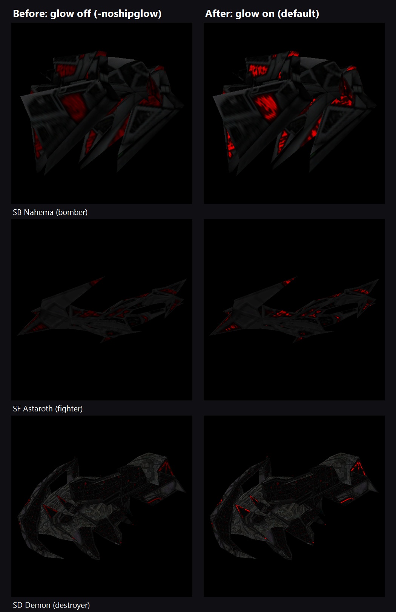
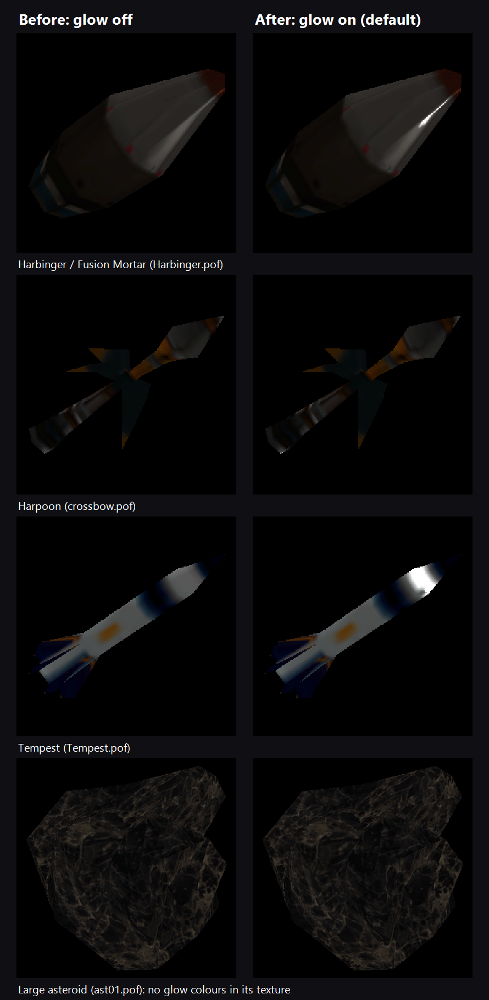

# Shivan ship glow (Glide-only "nondarkening" pixels)

## Status
- Branch `ShivanShipGlow`, off `RecordPlayback`, so the recorder and autotest
  can check it. It merges into `RecordPlayback`, not `VS2022`: it is a new
  feature, not an original-source fix.
- Implemented in D3D only (two passes, `code/Graphics/GrD3DGlow.cpp`), Shivan
  ships only, on by default. `-noshipglow` turns it off, `-noforceglow` turns
  off the forced-red rule. Glide's own path is untouched.
- The glow is a visual change only and must not change gameplay state. Verify
  with replay as for any change (see `CLAUDE.md`), with glow on and with
  `-noshipglow`. Both must pass.
- Open items: see "Open issues" at the end.

## What it is
Under 3dfx Glide, chosen texture colours on ship models are drawn at full brightness
whatever the lighting. The red lights and markings on Shivan hulls stay lit while
the rest of the ship darkens as it turns away from the sun. D3D never had it: there,
every pixel follows the vertex lighting.

The code came over from FS1 into the FS2 source (FS1 source was never released).

## How it works under Glide
1. **Choosing the colours.** Up to 10 exact RGB values (`MAX_NONDARK_COLORS`).
   - `pixels.tbl`, `+ND r g b` lines: the default list (`palman_load_pixels`,
     `code/Palman/PalMan.cpp`).
   - `ships.tbl`, `$ND: r g b` lines after `$Detail distance:`: a per-ship override
     (`code/Ship/Ship.cpp`, ship table parse).
   - The active list is swapped per ship before its textures load
     (`palman_set_nondarkening`, called from `model_page_in_textures` in
     `code/Model/ModelInterp.cpp` and from bmpman under `BMPMAN_SPECIAL_NONDARK`).
2. **Marking the pixels.** Ship textures are loaded as 16-bit ARGB with
   `BMP_TEX_NONDARK` (`pcx_read_bitmap_16bpp_nondark`, `code/PcxUtils/pcxutils.cpp`).
   - A pixel whose palette colour exactly matches a listed colour gets alpha 255.
   - Every other pixel gets alpha 0.
   - The alpha channel is a glow mask, not transparency.
3. **Drawing.** Ship polygons are drawn with `TMAP_FLAG_NONDARKENING`
   (`code/Model/ModelInterp.cpp`, textured poly draw; not for `MR_ALL_XPARENT`).
   - `GrGlide.cpp` maps that flag to `ALPHA_SOURCE_VERTEX_NONDARKENING` and texture
     type `TCACHE_TYPE_NONDARKENING`.
   - That state calls `grAlphaControlsITRGBLighting(FXTRUE)` and
     `grConstantColorValue(0xFFFFFFFF)`. This is a Voodoo hardware feature: where
     the texel alpha is set, the card lights the pixel with the constant colour
     (white) instead of the iterated vertex colour.
   - Result: masked pixels show the raw texture colour; the rest are texture x lighting.

## Why D3D does not have it
- `model_page_in_textures` and the ship/weapon/asteroid page-in code request
  `BMP_TEX_NONDARK` only when `gr_screen.mode == GR_GLIDE`; D3D gets `BMP_TEX_OTHER`.
- `bm_lock` asserts that D3D never asks for `BMP_TEX_NONDARK` (`code/Bmpman/BmpMan.cpp`).
- `GrD3DTexture.cpp` hits `Int3()` on `TCACHE_TYPE_NONDARKENING`.
- The D3D tmapper ignores `TMAP_FLAG_NONDARKENING`.

## What the retail tables use
- `pixels.tbl` (default list): `+ND` 255 255 255, 41 41 255, 255 0 0, 0 255 0, 255 244 126.
- `ships.tbl`: 22 classes carry their own `$ND:` list, e.g. GTF Ares, GTF Myrmidon,
  GTD Hecate, GTCv Deimos, NTF Iceni, GVCv Sobek, SF Aeshma, SF Astaroth,
  SB Nahema, SD Ravana, Knossos. Every other model uses the default list, which is
  how most Shivan hulls get their red (255 0 0) lights.

## D3D implementation

The original plan (two texture stages, glow mask in the base texture's alpha) does
not fit this code: the D3D device is `IDirect3DDevice2` (DirectX 5), which has one
texture and no texture stages, and the base textures already use their alpha bit
for transparency (1555, `BM_PIXEL_FORMAT_ARGB_D3D`). So it is done in two passes
with a separate texture:

1. **Pass 1** is the normal lit draw, unchanged.
2. **Pass 2** (`gr_d3d_tmapper_internal`, `GrD3DRender.cpp`) redraws the same
   polygon when `TMAP_FLAG_NONDARKENING` is set, with:
   - the texture's **glow texture**: the texture's own colours, with alpha set
     only where the pixel glows;
   - vertex colour white (vertex alpha and fog kept);
   - alpha blend `SRCALPHA / INVSRCALPHA`, z read only (same verts, so the
     default `LESSEQUAL` passes).
   The result is `lerp(texture * light, texture, mask)`, what Glide produced.
3. Pass 2 only runs for normal opaque textured polys: not for bitmap sections,
   additive/filter blending (`MR_ALL_XPARENT` never sets the flag anyway), or
   textures with no glowing pixels.

Glow textures (`code/Graphics/GrD3DGlow.cpp`):
- **Never built during play.** They are built:
  - at the end of level load, for every texture of every loaded model
    (`d3d_glow_level_load`, called from the end of `bm_page_in_stop`);
  - after a texture cache flush (detail or gamma change, alt-tab), on the next
    frame flip (`d3d_glow_frame`, called from `d3d_tcache_frame`). These happen
    from the options menu or on returning to the game window;
  - outside a mission (tech room, briefing), on first use.

  In a mission (`GM_IN_MISSION`), a texture with no glow texture is drawn
  without glow; nothing is loaded mid-frame.
- Cached per bitmap handle (indexed by `bm_get_cache_slot`, like the texture
  cache) and released in `d3d_tcache_flush()`, so they follow the texture
  cache's lifetime: level load, detail change, mode change, alt-tab, shutdown.
- Built straight from the 8-bit PCX (`pcx_read_bitmap_8bpp`): a palette entry
  glows if its RGB exactly matches the colour list, as `palman_is_nondarkening`.
  The PCX must be the same size as the bitmap, which skips ANI frames.
- The transparent colour (0 255 0, as in `pcx_read_bitmap_16bpp`) never glows,
  even though the retail default list contains it. Pass 1 leaves those pixels
  see-through, and pass 2 leaves them alone.
- Non-glowing texels keep their real colour with alpha 0. Bilinear filtering
  then mixes colour and mask exactly as Glide's single masked texture did, so
  the edges of a light have no dark fringe.
- **Shivan ships only** (`GLOW_SHIVAN_ONLY`, `GrD3DGlow.cpp`). A texture glows
  only if a ship class with `$Species: Shivan` uses it. The lookup matches
  loaded models to ship classes by POF file name, so it works in the tech room
  as well as in missions. Set `GLOW_SHIVAN_ONLY` to 0 for Glide's behaviour,
  where every model texture can glow.
- Colour list: that Shivan class's `$ND:` list, else the `pixels.tbl` default.
  Glide uses the same lists (`BMPMAN_SPECIAL_NONDARK`). They are read directly
  and palman's global current list is never changed.
- Same size and nearest-texel scaling as the base texture
  (`d3d_create_texture`), so glow texels line up with base texels.
- Format: the normal texture format when it has alpha (1555), else the alpha
  format (4444).
- VRAM:
  - Glow textures may use at most 1/8 of the texture VRAM the card reported at
    startup (`GLOW_VRAM_DIVISOR`); past that, textures get no glow.
  - If the texture cache still runs out of VRAM, its flush also frees every
    glow texture, and glow stays off until the next level.
  - A failed build (not a PCX, no alpha format, no VRAM) marks the texture
    "no glow", and it draws as before.

Which models glow (retail data, every ship class and weapon/asteroid/debris
model surveyed, "px" = glowing texels in the model's textures):
- **Glow (Shivan):** SB Seraphim 113951, SB Nephilim 37542, SFr Asmodeus 16106,
  ST Azrael 5343, SD Demon 2422, SB Taurvi 2232, SB Nahema 2214,
  Shivan Comm Node 1162, SSG Trident 975, SF Astaroth 842, SD Ravana 607,
  SFr Mephisto 463, SAC 2 164, SJ Sathanas 83, SC Lilith / SC Cain 47, SC 5 8.
- **Shivan, but no glow colours in their textures:** SF Dragon, SF Basilisk,
  SF Manticore, SF Aeshma, SF Mara, SFr Dis, SAC 3, SC Rakshasa, SD Lucifer,
  SSG Belial, SSG Rahu, SCv Moloch, SJD Sathanas, SpaceHunk.
- **Excluded by the Shivan-only rule** (glowed under Glide):
  - Terran: GTF Hercules 1, GTF Hercules Mark II 512, GTF Ares 39,
    GTF Erinyes 1680, GTF Pegasus 836, GTF Myrmidon 42, GTB Artemis D.H. 49,
    GTB Medusa 159, GTB Ursa 14, GTB Zeus 371, GTS Hygeia 654,
    GTFR Triton 14181, TC 2 / TSC 2 53, TAC 1 55, GTM Hippocrates 315,
    GTSC Faustus 602, GTA Charybdis 140, GTD Orion 751, GTD Hecate 309,
    GTD Orion#2 (Bastion) 1490, GTD Hades 230, GTI Arcadia 4530,
    GTCv Deimos 175, NTF Iceni 350, NTF Boadicea 1182, GTT Elysium 154,
    Knossos 492, GTSG Watchdog / Cerberus 182, Volition Bravos 1302.
  - Vasudan: GVF Seth 21, GVF Thoth 13, GVB Sekhmet 129, GVB Osiris 484,
    GVB Bakha 28559, GVF Ptah 1505, GVS Nephthys 1056, GVT Isis 308,
    PVFR Ma'at 1811, VAC 4 42, GVFr Satis 4588, GVG Anuket 3286, GVC Aten 18,
    GVC Mentu 79, GVCv Sobek 275, GVD Typhon 1966, GVSG Ankh 210,
    GVA Setekh 62.
  - Weapons: Harbinger / Fusion Mortar 46, Harpoon 67, Tempest 46, Hornet 2.
    Their pure-white (255 255 255) highlights would glow, as the default
    list includes white.
- **Never glow (no glow colours in their textures):** all asteroids, Terran and
  Vasudan debris, the subspace node, and all other weapon models.

Weapons and an asteroid with the rule off (`GLOW_SHIVAN_ONLY` 0), for reference:

Glide is untouched: its own path still handles nondarkening there.

### Switching it off
- On by default.
- `-noshipglow` on the command line turns it off for the whole run and builds
  no glow textures (`Cmdline_no_ship_glow`).
- Forced red, on by default, not in the original: on Shivan ships, strong reds
  (red >= 170, green and blue <= 10; `GLOW_FORCE_MIN_RED`, `GLOW_FORCE_MAX_GB`)
  glow too, which lights the many Shivan ships with no exact glow colours (see
  `docs/glow_compare/`). It also lights painted red panels on the SSG Rahu.
  `-noforceglow` turns it off, leaving only the table colours.
- Debug builds only: the console command `ship_glow` toggles it
  (`D3D_ship_glow`). It cannot override `-noshipglow`.

### Gameplay and record/playback safety
The glow is render-only:
- It runs only inside the D3D tmapper, the texture cache flush and frame flip,
  and the end of level load.
- It reads tables (`Ship_info`, palman's default list), the PCX files, the
  loaded models' texture lists and `Game_mode`.
- It writes only its own glow cache and D3D render state.
- It does not touch the RNG, timers, `Ship_info`, palman's current list,
  bmpman's bitmaps or the texture cache's slots. The only cross-module effects
  are an extra `gr_tcache_set(-1, ...)` (makes the next draw rebind its base
  texture) and the three hook calls above.
- PCX reads happen at level load or in menus, never mid-mission, so there is no
  frame-time hitch during play.
- `-noshipglow` and the console toggle change only what is drawn.
- Z-fighting: pass 2 draws the same screen-space vertices with the same depth
  and z-bias, and only reads z (`LESSEQUAL`). It can't fight with pass 1 and
  never hides later geometry.

### Known limitations
- A texture shared by several Shivan ship classes uses the first class's
  `$ND:` list (same as Glide).
- A model first loaded mid-mission (rare; mission load pages in all classes)
  gets no glow until the next level.
- Every glowing polygon is drawn twice. Cheap on any modern card.

### Porting notes
- The data is 1:1 with the original: `$ND:` per ship class, `+ND` default, exact
  RGB match against the 8-bit palette. Build a one-bit (or 8-bit) mask per
  texture at load time.
- On any renderer with shaders or texture stages it is one pass:
  `out = lerp(tex.rgb * light, tex.rgb, mask)`, with fog applied after.
  Keep the base texture's transparency separate from the mask.
- Godot: a `ShaderMaterial` with `ALBEDO = tex.rgb * (1.0 - mask)` and
  `EMISSION = tex.rgb * mask` gives exactly the lerp above. Plain
  `EMISSION = tex.rgb * mask` with full albedo is close but slightly brighter. Bloom is not part of the original
  effect, so leave it off for a faithful look.
- The mask is a per-texture property, not per-object: no per-frame state,
  nothing to serialise or record.

Optional pulse (not in the original, not implemented): scale the glow term over
time, for example `0.5 + 0.5 * sin(t)`.

## Open issues
- **SC Rakshasa (`cruiser2s-01.pof`) barely glows. Needs a decision.**
  - It has no `$ND:` list, and its textures contain none of the default
    colours.
  - Its lights are dark reds, mostly red 90-150 with green/blue near 0. The
    forced-red rule (red >= 170) catches only 917 of about 11,000 reddish
    texels.
  - Widening the rule to red >= 110, green/blue <= 40 lights about 7,700, but
    it stays dim, because the glow shows the texture colour unlit, not
    brighter. Comparison: `docs/glow_compare/rakshasa_thresholds.png`.
  - Options:
    - a per-ship override with a wider threshold for the Rakshasa;
    - a wider threshold for all Shivan ships (re-check the sheets, the SSG Rahu
      already lights whole panels);
    - a brightness boost on the glow pass (not in the original).
  - Left as is for now.
- SFr Dis is in the same state (dark reds, faint glow).
- Not yet checked against recorder replays. The branch now sits on
  `RecordPlayback` (which includes `OriginalSourceBugFixes`), so this can be
  done here.
- Ship comparison sheets for every Shivan model (glow off / table colours /
  forced red), rendered with darkened lighting: `docs/glow_compare/`.
